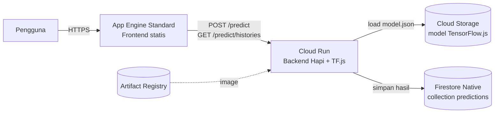

# Asclepius — Aplikasi Deteksi Kanker Kulit di Google Cloud

Aplikasi machine learning berbasis web yang mengklasifikasikan gambar kulit menjadi **Cancer** atau **Non-cancer**,
dibangun dan di-deploy sepenuhnya di Google Cloud. Proyek akhir kelas *Belajar Penerapan Machine Learning dengan Google Cloud* (Dicoding).

## Arsitektur



| Komponen | Layanan | Catatan |
|---|---|---|
| Frontend | App Engine standard (`nodejs24`, handler statis) | Kode frontend disediakan Dicoding ([dicodingacademy/asclepius](https://github.com/dicodingacademy/asclepius)); hanya `BASE_URL` di `src/scripts/api.js` dan `app.yaml` yang ditambahkan |
| Backend | Cloud Run (`asia-southeast2`, 2 GiB, scale-to-zero) | Node.js 18, Hapi, `@tensorflow/tfjs-node@3.21.1` |
| Model | Cloud Storage | Graph model MobileNetV3 (input 224×224×3), dimuat dari `MODEL_URL` |
| Database | Firestore (Native mode, database `(default)`) | Collection `predictions`, nama dokumen = id prediksi |
| Identitas | Service account khusus backend | Hanya `roles/datastore.user` — tanpa file key |

## API

| Method | Path | Keterangan |
|---|---|---|
| `POST` | `/predict` | `multipart/form-data`, field `image` (maks. 1.000.000 byte). `201` berisi `id`, `result`, `suggestion`, `createdAt` |
| `GET` | `/predict/histories` | Seluruh riwayat prediksi dari Firestore |

Penanganan error (diseragamkan di `onPreResponse`):
- Gambar > 1 MB → `413` `Payload content length greater than maximum allowed: 1000000`
- Gambar tidak sesuai shape/format model (mis. grayscale) → `400` `Terjadi kesalahan dalam melakukan prediksi`

## Keamanan & IAM
- Backend memakai service account khusus dengan satu role (`Cloud Datastore User`); tidak ada credential di repository.
- Auditor eksternal diberi akses **least privilege**, hanya role read-only per layanan:
  Browser, App Engine Viewer, Cloud Run Viewer, Cloud Datastore Viewer, Artifact Registry Reader,
  Storage Bucket Viewer, dan Storage Object Viewer khusus pada bucket model.

## Deploy ulang
```bash
PROJECT=<project-id>; REGION=asia-southeast2; BUCKET=<bucket-model>

# Model (unduh dari rilis Dicoding: submissions-model.zip) → Cloud Storage
gcloud storage buckets create gs://$BUCKET --location=$REGION --uniform-bucket-level-access
gcloud storage cp model/* gs://$BUCKET/model/
gcloud storage buckets add-iam-policy-binding gs://$BUCKET --member=allUsers --role=roles/storage.objectViewer

# Firestore + App Engine
gcloud firestore databases create --location=$REGION --type=firestore-native
gcloud app create --region=$REGION

# Backend → Cloud Run (service account khusus, hanya datastore.user)
gcloud iam service-accounts create asclepius-backend
gcloud projects add-iam-policy-binding $PROJECT \
  --member=serviceAccount:asclepius-backend@$PROJECT.iam.gserviceaccount.com --role=roles/datastore.user
cd backend && gcloud run deploy asclepius-backend --source . --region $REGION --allow-unauthenticated \
  --service-account asclepius-backend@$PROJECT.iam.gserviceaccount.com --memory 2Gi \
  --set-env-vars MODEL_URL=https://storage.googleapis.com/$BUCKET/model/model.json

# Frontend → App Engine (isi BASE_URL di src/scripts/api.js dengan URL Cloud Run)
cd ../frontend && gcloud app deploy app.yaml
```

## Hasil pengujian
Postman collection resmi (folder *Mandatory* + *Opsional*): **5/5 request, 15/15 assertion lulus**.
Submission diterima reviewer Dicoding.

> Infrastruktur Google Cloud (`requirements.json`) sudah dihapus setelah review selesai,
> sehingga URL di dalamnya tidak lagi aktif.
